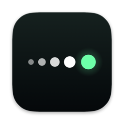

<h1 align="center">Sorello</h1>

- [Sorello](https://github.com/audeolabs/sorello/releases/latest/download/Sorello.dmg), the latest stable release.
- [Sorello Nightly](https://github.com/audeolabs/sorello/releases/download/nightly/Sorello-Nightly.dmg), to stay on top of
  the latest updates. Things may break, you never will.

Sorello is an English dictation app for Mac that runs entirely on device. Hold a key, speak, and let go: your words
are pasted where the cursor is. It is powered by the Kea family of English speech models by
[Audeo Labs](https://huggingface.co/audeolabs). [Using Sorello](docs/USING.md) covers in depth setup, shortcuts and settings. 
Consult [docs/DEVELOPMENT.md](docs/DEVELOPMENT.md) for how to contribute or build your own.

## Requirements

- macOS 26 or later.
- A Mac with Apple silicon (M series).
- The microphone and Accessibility permissions.

## Privacy

We take privacy very seriously. As such, no audio or transcription data ever leaves your device, and all 
transcription is done fully on your machine. We collect no analytics, crash reporting, or identifiable information.

## License

Sorello's code is under the [MIT License](LICENSE). The speech model, kea-b-0.1, is under CC BY 4.0. Its notices,
and the other work Sorello includes, are in [ThirdPartyNotices.md](ThirdPartyNotices.md).
